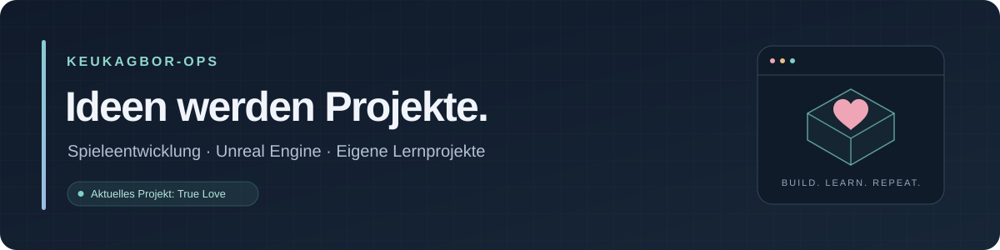

# Hi, ich bin Kelvin.

Ich beschäftige mich mit **Software- und Spieleentwicklung** und lerne am liebsten an eigenen Projekten. Auf GitHub dokumentiere ich meine Fortschritte und die nächsten Schritte meiner Ideen.

## Aktuell: True Love

Ein persönliches Spielprojekt über Liebe und gemeinsame Erlebnisse. Der erste Entwicklungsstand entsteht mit **Unreal Engine und Blueprints** und bildet die Grundlage für die weitere Ausarbeitung der Spielidee.

| Projekt | Technik | Stand |
| :--- | :--- | :--- |
| **[True Love](https://github.com/keukagbor-ops/TrueLove)** | Unreal Engine 5.8 · Blueprints · Enhanced Input | **v1 — früher Prototyp** |

Im Repository findest du den Projektstand mit Intro-Level, First-Person-Basis und FBX-Export sowie eine Beschreibung zum Öffnen im Unreal Editor. Die erste Version baut auf vorhandenen Unreal-Vorlagen auf.

**[Projekt ansehen →](https://github.com/keukagbor-ops/TrueLove)** &nbsp; · &nbsp; **[Version 1 herunterladen →](https://github.com/keukagbor-ops/TrueLove/releases/tag/v1.0.0-prototype)**

## Was ich dabei lerne

- **Unreal Engine & Blueprints:** Aufbau eines Spielprojekts und Arbeit mit vorhandenen Blueprint-Assets.
- **Levelaufbau & Assets:** Szenen, Räume und Quelldateien im Projekt organisieren.
- **Git & GitHub:** Entwicklungsstände versionieren und Projekte verständlich dokumentieren.

Als Nächstes möchte ich den Intro-Raum weiter ausarbeiten und erste persönliche Interaktionen für True Love entwickeln.

---

**Mein Ansatz:** ausprobieren, verstehen, verbessern — und den Fortschritt sichtbar machen.

